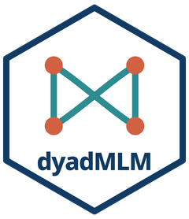
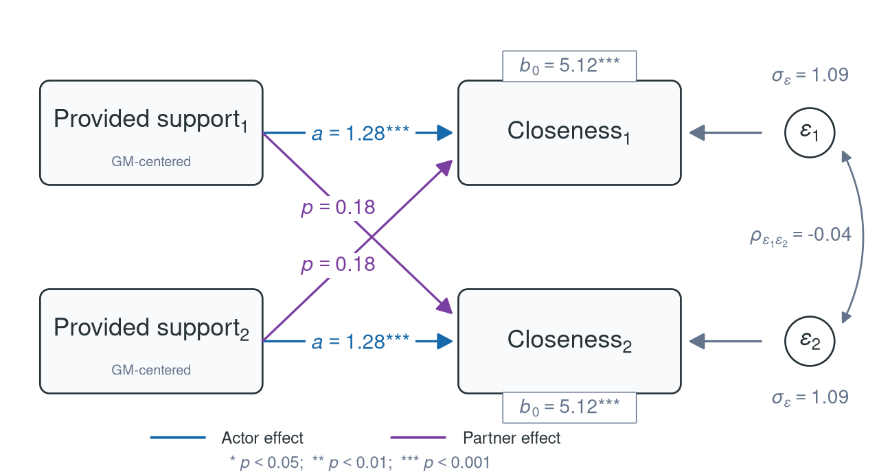
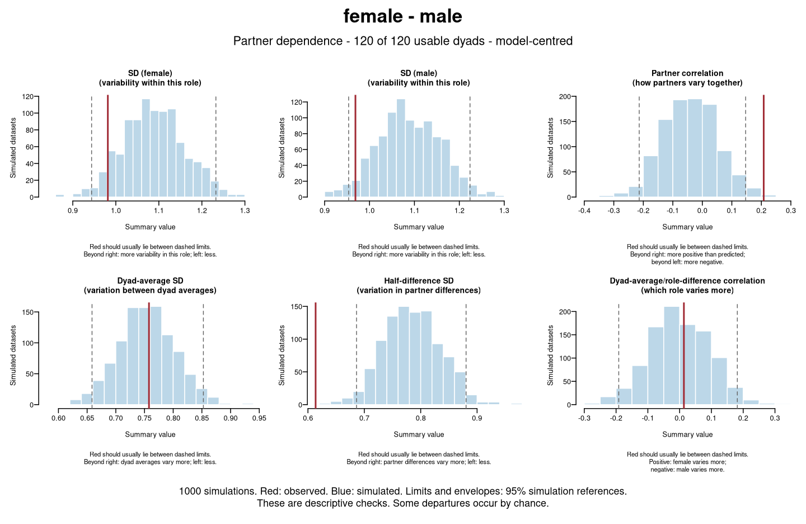
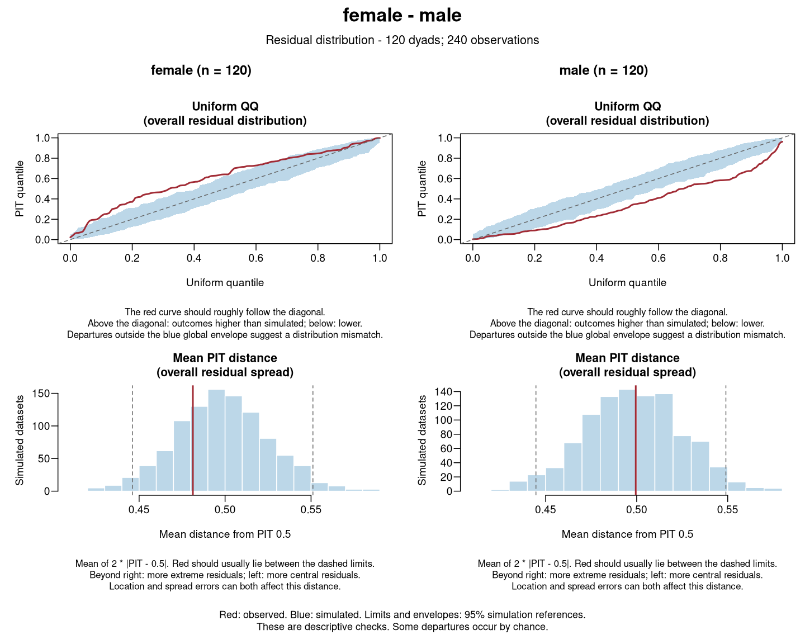
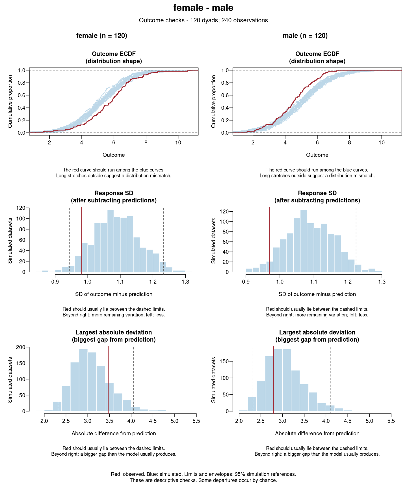

<!-- README.md is generated from README.Rmd. Please edit that file -->

# dyadMLM: Tools for Dyadic Multilevel Models 

<!-- badges: start -->

[](https://github.com/Pascal-Kueng/dyadMLM/actions/workflows/R-CMD-check.yaml)
[](https://app.codecov.io/gh/Pascal-Kueng/dyadMLM)
[](https://CRAN.R-project.org/package=dyadMLM)
[](https://CRAN.R-project.org/package=dyadMLM)
[](https://doi.org/10.5281/zenodo.21481720)
<!-- badges: end -->

`dyadMLM` provides tools for dyadic multilevel modeling with linear and
generalized linear mixed-effects models.

It provides functions for data preparation for various types of dyadic
models and post-estimation tools for interpretation and checking of
model assumptions.

If you use `dyadMLM`, please cite it as:

Küng, P. (2026). *dyadMLM: Tools for dyadic multilevel models*
\[Computer software\]. <https://doi.org/10.5281/zenodo.21481720>

To include the version you used, see [Citation](#citation).

## Installation

Install the stable release from CRAN:

``` r
install.packages("dyadMLM")
```

To try the latest changes and help test upcoming features, install the
development version:

``` r
install.packages(
  "dyadMLM",
  repos = c(
    "https://pascal-kueng.r-universe.dev",
    "https://cloud.r-project.org"
  )
)
```

## Data preparation and validation

[`prepare_dyad_data()`](https://pascal-kueng.github.io/dyadMLM/reference/prepare_dyad_data.html)
validates dyadic data and creates model-ready columns for:

- ✅ **[Actor-Partner Interdependence Model
  (APIM)](https://pascal-kueng.github.io/dyadMLM/articles/apim.html):**
  distinguishable and exchangeable dyads.
- ✅ **[Dyad-Individual Model
  (DIM)](https://pascal-kueng.github.io/dyadMLM/articles/dim.html):**
  exchangeable dyads.
- ✅ **[Dyadic Score Model
  (DSM)](https://pascal-kueng.github.io/dyadMLM/articles/dsm.html):**
  distinguishable dyads.

It supports cross-sectional and intensive longitudinal dyadic data
(e.g., daily diary data). The package also supports datasets containing
multiple dyad compositions.

Preparation options include selecting and pooling compositions, treating
selected compositions as exchangeable, centering predictors, and
creating within-/between-person components and lagged predictors.

Prepared data can be used with **glmmTMB**, **brms**, and other
multilevel modeling packages that support the required model structure.
See the [Getting Started
vignette](https://pascal-kueng.github.io/dyadMLM/articles/getting-started.html)
for data requirements and examples.

## Post-estimation tools

| Tool | glmmTMB | brms |
|----|----|----|
| [Compare nested models](https://pascal-kueng.github.io/dyadMLM/reference/compare_nested_models.html) | ✅ Supported | Not implemented · [Contribute](https://github.com/Pascal-Kueng/dyadMLM/blob/main/.github/CONTRIBUTING.md) |
| [Recover exchangeable member variances and partner covariances](https://pascal-kueng.github.io/dyadMLM/reference/recover_exchangeable_covariance.html) | ✅ Point estimates | ✅ Posterior summaries and draws |
| [Check partner dependence — cross-sectional](https://pascal-kueng.github.io/dyadMLM/reference/check_partner_dependence.html) | ✅ Experimental | Not implemented · [Contribute](https://github.com/Pascal-Kueng/dyadMLM/blob/main/.github/CONTRIBUTING.md) |
| [Check residuals](https://pascal-kueng.github.io/dyadMLM/reference/check_dyad_residuals.html) | ✅ Experimental | Not implemented · [Contribute](https://github.com/Pascal-Kueng/dyadMLM/blob/main/.github/CONTRIBUTING.md) |
| [Check outcomes](https://pascal-kueng.github.io/dyadMLM/reference/check_dyad_outcomes.html) | ✅ Experimental | Not implemented · [Contribute](https://github.com/Pascal-Kueng/dyadMLM/blob/main/.github/CONTRIBUTING.md) |

Predictive checks compare the *observed* data with data simulated from
the fitted model: outcome and residual distributions, variability, and
partner dependence. See
[`simulate_dyad_responses()`](https://pascal-kueng.github.io/dyadMLM/reference/simulate_dyad_responses.html)
for supported models. Simulation studies show how often the partner
check detects [omitted partner
dependence](https://pascal-kueng.github.io/dyadMLM/articles/partner-dependence-simulation.html)
and [incorrect covariance
pooling](https://pascal-kueng.github.io/dyadMLM/articles/covariance-pooling.html),
and how often the residual and outcome checks [flag correct and
mismatched
models](https://pascal-kueng.github.io/dyadMLM/articles/distribution-checks.html).

## Quick example

Using the bundled simulated data, we select female–male dyads and, for
illustration, fit an APIM that treats partners as exchangeable. We then
check whether it reproduces gender-specific variation and partner
dependence.

This example requires the development version of **dyadMLM**. It also
uses **glmmTMB**.

``` r
library(dyadMLM)

prepared_data <- prepare_dyad_data(
  dyads_cross,
  dyad = coupleID,
  member = personID,
  role = gender,
  predictors = provided_support,
  model_types = "apim",
  keep_compositions = "female-male",
  add_apim_gmc_predictors = TRUE,
  include_arbitrary_member_contrast = TRUE,
  seed = 123
)
```

This creates grand-mean-centred actor and partner predictors and a
member contrast for the exchangeable model. Inspect the prepared data
with `print()`:

``` r
print(prepared_data, n = 4)
#> # dyadMLM data
#> # Rows: 240 | Dyads: 120 | Intensive longitudinal: no
#> # Structure: dyad = coupleID, member = personID, role = gender
#> #
#> # Dyad compositions:
#> # female_x_male distinguishable 120 dyads
#> #
#> # Added columns:
#> #   .composition                inferred dyad composition
#> #   .composition_role           composition-specific member role
#> #   .is_{role}                  composition-role indicator columns
#> #   .member_contrast_arbitrary  composition-specific member contrasts coded
#> #                               -1/+1 in arbitrary direction for
#> #                               exchangeability-constrained random effects.
#> #                               Values are 0 for other compositions
#> #   .{pred}_actor               APIM actor predictor: actor's original
#> #                               predictor values
#> #   .{pred}_partner             APIM partner predictor: partner's original
#> #                               predictor values
#> #   .{pred}_gmc                 APIM grand-mean-centered predictor source:
#> #                               original values minus the mean across all
#> #                               retained non-missing observations
#> #   .{pred}_gmc_actor           APIM grand-mean-centered actor predictor:
#> #                               actor's value relative to the mean across all
#> #                               retained non-missing observations
#> #   .{pred}_gmc_partner         APIM grand-mean-centered partner predictor:
#> #                               partner's value relative to the mean across all
#> #                               retained non-missing observations
#> #
#> # A tibble: 240 × 15
#>   personID coupleID gender closeness provided_support .composition 
#>      <int>    <int> <fct>      <dbl>            <dbl> <fct>        
#> 1        1        1 female      4.71             4.49 female_x_male
#> 2        2        1 male        4.61             4.76 female_x_male
#> 3        3        2 female      6.69             4.09 female_x_male
#> 4        4        2 male        5.98             6.20 female_x_male
#> # ℹ 236 more rows
#> # ℹ 9 more variables: .composition_role <fct>, .is_female <dbl>,
#> #   .is_male <dbl>, .member_contrast_arbitrary <dbl>,
#> #   .provided_support_gmc <dbl>, .provided_support_actor <dbl>,
#> #   .provided_support_partner <dbl>, .provided_support_gmc_actor <dbl>,
#> #   .provided_support_gmc_partner <dbl>
```

Fit the exchangeable APIM:

``` r
model <- glmmTMB::glmmTMB(
  closeness ~
    # Pooled intercept
    1 +

    # Pooled actor and partner effects
    .provided_support_gmc_actor +
    .provided_support_gmc_partner +

    # Mean/half-difference parametrization:
    # common member variance and positive or negative partner correlation
    us(1 | coupleID) +
    us(0 + .member_contrast_arbitrary | coupleID),

  dispformula = ~ 0, # Fix the additional Gaussian residual variance near zero
  family = gaussian(),
  data = prepared_data
)
```

Inspect the fixed effects:

``` r
printCoefmat(coef(summary(model))$cond)
#>                               Estimate Std. Error z value Pr(>|z|)    
#> (Intercept)                   5.119168   0.068890 74.3095  < 2e-16 ***
#> .provided_support_gmc_actor   1.284590   0.094077 13.6546  < 2e-16 ***
#> .provided_support_gmc_partner 0.175526   0.094077  1.8658  0.06207 .  
#> ---
#> Signif. codes:  0 '***' 0.001 '**' 0.01 '*' 0.05 '.' 0.1 ' ' 1
```

Recover the member-level SDs and partner correlation:

``` r
covariance <- recover_exchangeable_covariance(model)

print(covariance, representation = "sdcor")
#> Recovered exchangeable member-level covariance
#> 
#> Pair `pair_1`
#> Shared:     us(1 | coupleID)
#> Difference: us(0 + .member_contrast_arbitrary | coupleID)
#> 
#> Standard deviations and correlations:
#>                        1      2     
#> 1 member1: (Intercept) 1.089  -0.039
#> 2 member2: (Intercept) -0.039 1.089
```

For illustration, the path diagram from the [APIM
vignette](https://pascal-kueng.github.io/dyadMLM/articles/apim.html#fitting-the-restricted-exchangeable-apim-with-glmmtmb)
shows these estimates:



Next, check whether the model reproduces the data.

<details>
<summary>Complete model-checking workflow (click to expand): partner-dependence, residual, and outcome checks, a distinguishable APIM, and a model comparison</summary>

Simulate responses and check partner dependence, using gender to
distinguish partners:

``` r
simulations <- simulate_dyad_responses(model, seed = 123)

check_partner_dependence(
  simulations,
  dyad = coupleID,
  role = gender,
  # Supply the fitting data because gender is not in the model formula.
  data = prepared_data
)
```



The function groups the six plots in one figure. Use `panels = FALSE` to
show them separately.

Here, simulations produce weaker partner correlations and larger SDs of
partner half-differences than observed (red lines), suggesting
**misfit**.

With mixed dyad compositions, each observed role pair gets its own
figure. It can be worthwhile to check plausible role distinctions even
when fitting an exchangeable model, since pooling can hide differences
in variances or partner correlations. These checks alone do not
establish whether fixed effects should be pooled ([nested model
comparisons](https://pascal-kueng.github.io/dyadMLM/reference/compare_nested_models.html)
can help assess those restrictions).

The same `simulations` can be reused with `check_dyad_residuals()` and
`check_dyad_outcomes()`. Use the same `dyad`, `role`, and `data`
arguments. The [APIM
vignette](https://pascal-kueng.github.io/dyadMLM/articles/apim.html#checking-residuals-and-outcomes)
shows a worked example.

``` r
check_dyad_residuals(
  simulations,
  dyad = coupleID,
  role = gender,
  data = prepared_data
)
```



Women’s QQ curve and PIT median rise above their envelopes and men’s
fall below, so women’s observed closeness is higher than simulated and
men’s is lower.

``` r
check_dyad_outcomes(
  simulations,
  dyad = coupleID,
  role = gender,
  data = prepared_data
)
```



The outcome ECDFs show the same shift, while response SDs and largest
deviations stay within their limits.

A next step is to fit a distinguishable APIM, as shown in the [APIM
vignette](https://pascal-kueng.github.io/dyadMLM/articles/apim.html).

``` r
model_distinguishable <- glmmTMB::glmmTMB(
  closeness ~
    # Gender-specific intercepts
    0 + .is_female + .is_male +

    # Gender-specific actor and partner effects
    .is_female:.provided_support_gmc_actor +
    .is_male:.provided_support_gmc_actor +
    .is_female:.provided_support_gmc_partner +
    .is_male:.provided_support_gmc_partner +

    # Gender-specific residual variances and their covariance
    us(0 + .is_female + .is_male | coupleID),

  dispformula = ~ 0,
  family = gaussian(),
  data = prepared_data
)
```

Use
[`compare_nested_models()`](https://pascal-kueng.github.io/dyadMLM/reference/compare_nested_models.html)
to compare the two nested models.

``` r
compare_nested_models(model, model_distinguishable)
#> Likelihood-ratio test for nested models fitted to equivalent data
#> Assumes mathematical nesting and an appropriate chi-squared reference distribution.
#> 
#>                       Df    AIC    BIC  logLik deviance  Chisq Chi Df
#> model                  5 731.67 749.07 -360.83   721.67              
#> model_distinguishable  9 652.22 683.55 -317.11   634.22 87.448      4
#>                       Pr(>Chisq)    
#> model                               
#> model_distinguishable  < 2.2e-16 ***
#> ---
#> Signif. codes:  0 '***' 0.001 '**' 0.01 '*' 0.05 '.' 0.1 ' ' 1
#> 
#> Conclusion (5% level): The likelihood-ratio test provides evidence that `model_distinguishable` fits better than `model` (p < 0.001).
```

Check the distinguishable model the same way, and see the [APIM
vignette](https://pascal-kueng.github.io/dyadMLM/articles/apim.html#checking-partner-dependence)
for how to read the checks.

</details>

## Vignettes and examples

For an overview of the available functions, see the [function
reference](https://pascal-kueng.github.io/dyadMLM/reference/index.html).

| Vignette | Focus |
|----|----|
| [Getting Started](https://pascal-kueng.github.io/dyadMLM/articles/getting-started.html) | Data structure, validation, dyad compositions, generated columns, and basic preparation |
| [Actor-Partner Interdependence Model](https://pascal-kueng.github.io/dyadMLM/articles/apim.html) | Cross-sectional and longitudinal APIMs, distinguishability checks, covariance recovery, random slopes, and AR(1) |
| [Dyad-Individual Model](https://pascal-kueng.github.io/dyadMLM/articles/dim.html) | DIM predictor construction, longitudinal models, and an interactive demonstration of equivalence to the exchangeable APIM |
| [Dyadic Score Model](https://pascal-kueng.github.io/dyadMLM/articles/dsm.html) | DSM predictor-score and contrast construction, longitudinal models, and the relationship to the distinguishable APIM |

The model-fitting examples use **glmmTMB**. Joint analysis of multiple
dyad compositions is also supported with glmmTMB.

For theoretical foundations and a practical walkthrough of dyadic data
analysis, from data preparation and model fitting to interpretation and
diagnostics using `dyadMLM` with `glmmTMB`, see the [Dyadic Data
Analysis Workshop](https://pascal-kueng.github.io/dyadMLM/workshop/).
For Bayesian APIM and DIM workflows using `dyadMLM` and `brms`, refer to
[Distinguishable and Exchangeable Dyads: Bayesian Multilevel
Modelling](https://pascal-kueng.github.io/05DyadicDataAnalysis/)
([source](https://github.com/Pascal-Kueng/05DyadicDataAnalysis),
[DOI](https://doi.org/10.5281/zenodo.17400655)).

## Citation

If you use `dyadMLM`, please cite the installed package version. Run:

``` r
citation("dyadMLM")
```

Or cite the package without specifying a version:

Küng, P. (2026). *dyadMLM: Tools for dyadic multilevel models*
\[Computer software\]. <https://doi.org/10.5281/zenodo.21481720>

<details>

<summary>

BibTeX (without version)
</summary>

``` bibtex
@Manual{dyadMLM,
  title = {dyadMLM: Tools for dyadic multilevel models},
  author = {Pascal Küng},
  year = {2026},
  doi = {10.5281/zenodo.21481720},
}
```

</details>

## Questions and contributing

Questions about using `dyadMLM`, specifying models, or interpreting
output are welcome in [Q&A
Discussions](https://github.com/Pascal-Kueng/dyadMLM/discussions/categories/q-a).

Feature or method ideas can be proposed in
[Ideas](https://github.com/Pascal-Kueng/dyadMLM/discussions/categories/ideas).

Please report any bugs you find or any concrete improvement suggestions
through
[Issues](https://github.com/Pascal-Kueng/dyadMLM/issues/new/choose).

Documentation, examples, tests, reviews, and code contributions are all
welcome. See the [contribution
guide](https://github.com/Pascal-Kueng/dyadMLM/blob/main/.github/CONTRIBUTING.md).
